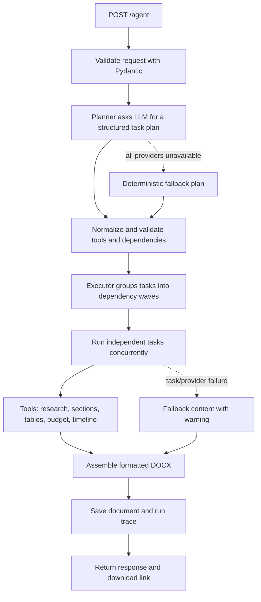

# AI Agent-Autonomous

Turn a plain-language request into a structured plan and a polished Word document. The agent plans its own tasks, executes independent work in parallel, records its decisions, and returns a downloadable `.docx` file with an execution trace.

<p align="center">
  
  
  
  
  
  
  
</p>

## What it does

Send a request such as:

> Create a 12-week project plan for launching a mobile app for a local bakery with a five-person team.

The agent creates a plan, turns it into executable tasks, drafts document sections and tables, and generates a formatted Word file. If a request is vague or contains conflicting constraints, it records assumptions and decisions for review.

## Features

- **Autonomous planning:** an LLM creates a task list using the tools available to the agent.
- **Validated execution:** plans are checked and normalized before tasks run.
- **Parallel task execution:** independent tasks run concurrently; dependencies determine execution order.
- **Useful document tools:** draft sections, build tables, estimate budgets, and create timelines.
- **Reliable LLM calls:** retries, JSON repair, provider fallback, and a circuit breaker.
- **Multiple providers:** Groq, Gemini, Ollama, and an offline mock provider.
- **Formatted Word output:** cover page, document-control table, contents, styled sections and tables, and an appendix.
- **Traceable runs:** API responses include task status, provider events, assumptions, and a document download link.

## Technology

| Area | Technologies |
|---|---|
| Language | Python 3.10+ |
| API | FastAPI, Uvicorn |
| Validation and configuration | Pydantic v2, pydantic-settings |
| Agent orchestration | Custom Planner and Executor using Python `asyncio` |
| LLM connectivity | httpx; OpenAI-compatible APIs for Groq, Gemini, and Ollama |
| Document generation | python-docx |
| Tests | pytest |

## Quick start

### Windows PowerShell

```powershell
cd C:\path\to\ai-doc-agent
python -m venv .venv
.\.venv\Scripts\python.exe -m pip install -r requirements.txt
if (-not (Test-Path .env)) { Copy-Item .env.example .env }
.\.venv\Scripts\python.exe -m uvicorn app.main:app --reload
```

### macOS / Linux

```bash
cd /path/to/ai-doc-agent
python3 -m venv .venv
source .venv/bin/activate
pip install -r requirements.txt
test -f .env || cp .env.example .env
uvicorn app.main:app --reload
```

Open the interactive API page at [http://127.0.0.1:8000/docs](http://127.0.0.1:8000/docs).

### Configure an LLM provider

Edit `.env` and add the API key for a provider you want to use:

```dotenv
LLM_PROVIDERS=groq,gemini,ollama,mock
GROQ_API_KEY=
GEMINI_API_KEY=
```

Get keys from [Groq Console](https://console.groq.com/keys) or [Google AI Studio](https://aistudio.google.com/apikey). Keep your keys private: do not paste them into source code, screenshots, or public repositories. The `.env` file is for local secrets; use `.env.example` as the safe configuration template.

For a local model, install and start [Ollama](https://ollama.com/), then pull a model:

```powershell
ollama pull llama3.1:8b
```

The default provider chain tries configured providers in order and falls back to `mock`. To run fully offline in PowerShell:

```powershell
$env:LLM_PROVIDERS = "mock"
python -m uvicorn app.main:app --reload
```

Mock mode is useful for demos and tests; generated content is rule-based and may be generic.

## Run the demo

With the API server running, open a second terminal in the project folder and run:

```powershell
python scripts\demo.py http://127.0.0.1:8000
```

The script submits both sample requests, prints the agent-generated task list and run information, and saves the Word documents here:

```text
demo_output\standard.docx
demo_output\complex.docx
```

The standard sample requests a bakery mobile-app launch plan with a 12-week timeline and five-person team. The complex sample asks for an AI customer-support proposal while presenting tradeoffs around budget, quality, schedule, and build-versus-buy.

## API

| Method | Endpoint | Description |
|---|---|---|
| `POST` | `/agent` | Generate a plan, execute its tasks, and return a document link and execution trace. |
| `GET` | `/health` | Check service status and list active providers and tools. |
| `GET` | `/runs/{run_id}` | Retrieve the saved JSON trace for a run. |
| `GET` | `/documents/{run_id}` | Download the generated Word document. |
| `GET` | `/docs` | Open the interactive Swagger UI. |

Example request:

```json
{
  "request": "Create a project plan for launching a mobile app for a local bakery with a 12-week timeline and a five-person team."
}
```

Try it with curl:

```bash
curl -X POST "http://127.0.0.1:8000/agent" \
  -H "Content-Type: application/json" \
  -d '{"request":"Create a project plan for launching a mobile app for a local bakery with a 12-week timeline and a five-person team."}'
```

Requests must contain 15–4,000 characters, at least four words, and at least one letter. The response includes a `run_id`, plan summary, task statuses, LLM call information, and the document download URL.

## How it works



1. **Plan:** the Planner supplies the LLM with the user request and the registered tool catalogue. The LLM returns a structured plan containing document metadata, assumptions, ambiguities, and tasks.
2. **Validate:** the Planner removes unknown tools, fixes duplicate task IDs and invalid dependencies, breaks cycles, limits plan size, and adds the final assembly task. If planning fails, it uses a deterministic fallback outline.
3. **Execute:** the Executor runs tasks in dependency waves. Independent tasks in a wave run concurrently, subject to the configured concurrency limit. A dependent task waits for its inputs.
4. **Generate:** tools create content blocks. The LLM drafts language, while Python code performs important budget and timeline calculations.
5. **Deliver:** the DocumentBuilder creates the `.docx`; the service saves it with a JSON run trace under `outputs/<run_id>/` and returns the download URL.

## LLM reliability

LLM calls can fail due to rate limits, unavailable services, or invalid structured output. The resilient client:

1. Retries transient errors with exponential backoff and jitter, honoring `Retry-After` when available.
2. Requests corrected JSON when a provider returns invalid or schema-incompatible output.
3. Falls through the configured provider chain when a provider cannot complete the request.
4. Uses a per-provider circuit breaker to temporarily skip providers that repeatedly fail.
5. Allows tools to return clearly marked fallback content so a provider failure does not silently look like successful model-generated content.

Provider attempts, latency, and errors are included in the response trace. API key and model configuration are managed through environment variables; see [.env.example](.env.example).

## Run tests

```powershell
python -m pytest -q
```

Tests cover the API, planning normalization, tool behavior, budget/timeline calculations, and LLM retry/fallback behavior.

## Run with Docker

Build the image:

```powershell
docker build -t ai-doc-agent .
```

Run it, mapping the API to port 8000:

```powershell
docker run --rm -p 8000:8000 --env-file .env ai-doc-agent
```

## Project layout

```text
app/
  agent/       Planner, task models, executor, and orchestration
  documents/   Word document builder
  llm/         Provider adapters, mock provider, and resilient client
  tools/       Built-in agent tools and tool registry
  data/        Local illustrative knowledge base
samples/       Standard and complex demo requests
scripts/       Demo runner
tests/         API, tools, planner, and LLM resilience tests
outputs/       Generated documents and run traces
demo_output/   Documents produced by the demo script
```

## Design tradeoffs and future ideas

- **Autonomous planning versus predictability:** the LLM adapts plans to different requests, while validation and deterministic fallback behavior reduce the risks of invalid plans. Plan content can still vary between runs.
- **Single-process simplicity versus scale:** the in-process async executor keeps setup straightforward. A background job queue, streaming progress, and multi-tenant controls could be added for larger deployments.
- **LLM flexibility versus numerical accuracy:** models draft prose and suggest inputs; deterministic code performs budget and date calculations.

## Security notes

- Never commit `.env` or share API keys. Use environment variables or a secrets manager for deployments.
- Keep this development server bound to localhost unless you have configured appropriate authentication and deployment security.
- Generated plans and documents should be reviewed before being used for important business or financial decisions.
